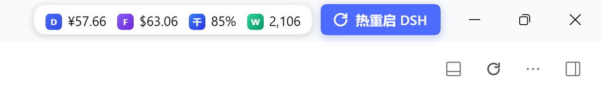
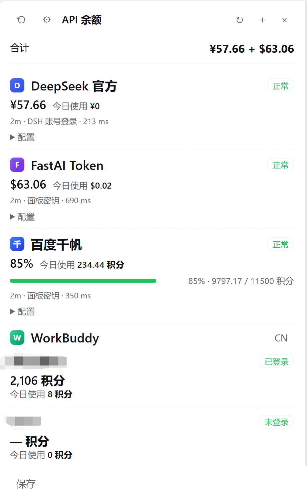
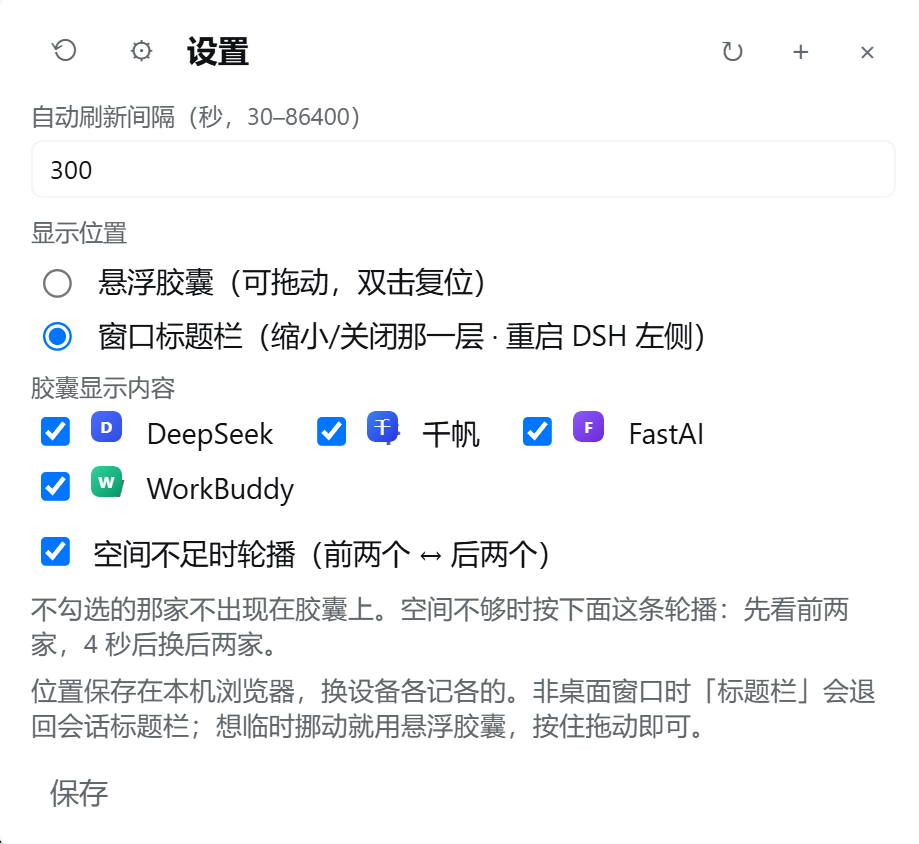

# dsh-api-balance

DeepSeek Harness 插件：把 **DeepSeek 官方余额、第三方 API 余额/套餐余量、WorkBuddy 积分** 收在一处显示。
胶囊默认浮在右下角可随意拖动，也可以固定到窗口标题栏（缩小/关闭那一层，重启 DSH 按钮左侧）；位置、刷新间隔、胶囊上显示哪几家、空间不足时是否轮播，都在 **DSH 设置 → API 余额** 里改，也可以点胶囊面板里的 `设置` 按钮。

- 三家余额已验证可用：DeepSeek（账号登录，免 Key）、FastAI（Bearer 令牌，401 自动续期）、百度千帆（控制台 Cookie，积分套餐）。
- 数据全部由**宿主侧**抓取，浏览器只负责显示与编辑；密钥只存在本机 `~/.dsh/api-balance/config.json`（0600），不进 patch、不进 Web UI 存储。
- 每天 00:00 抓一次基线，之后每次刷新累加当天用量，历史保留 30 天。

**出问题了先看 [TROUBLESHOOTING.md](TROUBLESHOOTING.md)**：胶囊不见了、点不动、某家 401、改了代码不生效、气泡消失、数据要重置，那里都是可直接照做的步骤。

## 目录结构

```
dsh-api-balance/
├── package.json          # 清单：bundle patch + dsh.client + exports + files
├── cordis.patch.yml      # 把插件挂进 profile 的 patch（只有一行实际配置）
├── index.js              # 宿主半：配置、轮询、历史、四条本地路由
├── client.js             # 浏览器半：胶囊 + 面板 + 设置 + 历史
├── icon.svg              # 插件图标原件（≤256 KiB）
├── locale/               # 显示元数据 en zh de es fr ja pt ru
│   ├── en.json  zh.json  de.json  es.json
│   └── fr.json  ja.json  pt.json  ru.json
├── tools/
│   └── harvest-fastai.mjs # 一次性抓 FastAI 的 access + refresh（先验证再写配置）
├── TROUBLESHOOTING.md    # 出问题怎么办：先看哪里、改哪个文件、跑哪条命令
└── README.md
```

## 数据流

```
浏览器 (client.js)                          宿主 (index.js)                外部 API
  GET  /plugins/dsh-api-balance/state       快照（不含密钥，含今日用量与 7 天历史）
  GET  /plugins/dsh-api-balance/config      配置（apiKey / refreshToken 已脱敏）
  POST /plugins/dsh-api-balance/config      保存（接受明文密钥）
  POST /plugins/dsh-api-balance/refresh     立即轮询一次
                                            定时器 ── fetch ──→ DeepSeek / 千帆 / FastAI / 自定义
                                            00:00:05 ──→ 写 history.json 当日基线
  GET  /plugins/dsh-connect-workbuddy/…     ← 读兄弟插件的积分路由（不存凭据）
```

四条路由都先过 `connection.requestRejection(req)`（同源围栏），只对本机回环开放。

## 安装

```
plugin_manager install_bundle  <本插件目录的绝对路径>
```

装好后刷新 Web 页面。卸载：`plugin_manager remove_bundle dsh-api-balance`（配置与历史留在 `~/.dsh/api-balance/`）。

重载（改了代码之后）：插件管理器里停用再启用，等价于
`plugin_manager set_plugin`，`target` 用 **`include:dsh-api-balance`**（写包名会报 `unknown-plugin`）。

## 显示位置（设置里选）

胶囊有两种落点，配置存在浏览器 localStorage `dsh-api-balance:placement`：

| 值 | 落点 | 槽位 |
| --- | --- | --- |
| `float`（默认） | 悬浮胶囊，可拖动 | `shell.overlay`，order 70 |
| `header` | **窗口标题栏**：缩小/最大化/关闭那一层，`right:146px; top:6px`（三个 46px 窗口按钮 + 8px 间隙）；检测到 `#dsh-hr-btn`（重启 DSH 的按钮）时自动再左移到它左边 8px。这一格用 `createPortal` 挂到 `<body>`：overlay 层在被裁的 frame 里，留在原地会被 frame 切掉一截 | `shell.overlay` 里的 `dsh-api-balance-titlebar`，order 72，`z-index:2147482000`、`app-region:no-drag` |
| `header`（浏览器形态） | 没有标题栏时退回会话标题栏最右（`dsh-unlag`=29 左边） | `conversation.session.header.utilities`，order 28 |

- `float` 模式：按住胶囊拖动换位置，位置按「距右/距下」存进 `dsh-api-balance:pos`，**双击复位**；拖到屏幕上方时面板向下弹。
- `header` 模式：胶囊变成行内小按钮，没有拖动。
- 标题栏座位只在桌面壳成立（`html[data-windows-titlebar]`，或旧壳 UA 里的 `DSHDesktop/`），且全屏（`data-fullscreen`）时自动让位；浏览器窗口里同一份 `header` 设置走会话标题栏，两个座位互斥、不会同时出现两个胶囊。
- 面板本身是居中浮层，不跟随胶囊，点面板外任意位置或按 Esc 收起。

设置入口有三个，改的是同一份状态（localStorage `dsh-api-balance:placement`），改完立刻生效，不必重载插件：

1. **DSH 设置 → API 余额**（`settings.section`，order 55）——推荐，和别的插件设置并排；
2. 胶囊面板标题栏的 `设置` 按钮；
3. 会话标题栏的齿轮按钮（`conversation.session.header.actions` order 5）。

面板自身是独立座位（`shell.overlay` 里的 `dsh-api-balance-panel`，order 71），**留在 overlay 层里、不 portal**：它居中在应用区域内，不需要跑到窗口层。只有**窗口标题栏那一格**用 `createPortal` 挂到 `<body>`，因为 overlay 层处在一个会裁剪的 frame 里，留在原地会被切掉一截。`react-dom` 是 DSH 共享模块表里的一份（`dsh-better-sidebar`、`dsh-config-manager` 都在用），`require` 失败时这个座位会退回就地渲染，不会报错。每个座位还包了一层错误边界 `Guard`：本插件渲染出错只隐藏自己那一格，不会连带同一层的其它插件气泡。

### 胶囊显示哪些、放不下怎么办

设置页的「胶囊显示内容」四个勾选框决定哪几家上胶囊（存 `dsh-api-balance:pill-mask`，未勾选的不出现，但面板里照常显示全部）。之所以要能关，是因为这枚胶囊常常被塞进一条本来就快满的窄条（窗口标题栏要在窗口按钮左侧停下），四家全上就必然溢出。

溢出不靠估算判断：胶囊的文本容器设 `min-width:0` + `overflow:hidden`，外层那条带子给 `max-width:100%`，所以浏览器自己算出来的 `scrollWidth > clientWidth` 就是「放不下了」的确切答案。放不下且「空间不足时轮播」开着（`dsh-api-balance:pill-cycle`，默认开），胶囊每 4 秒在**前两家 ↔ 后两家**之间切换；只有两家或更少时不轮播。胶囊宽度变化（手动刷新、切换页面）后会重新测量，窗口 resize 也重测。

## 界面

**窗口标题栏**：缩进右上角，停在「热重启 DSH」左侧，图标与数字上下居中；窗口按钮（最小化/最大化/关闭）不受影响，整条标题栏照旧可以拖动窗口。



**面板**：合计、每家余额或配额、每家的「今日使用」、WorkBuddy 多账号列表。



**设置页**（DSH 设置 → API 余额，与面板里的 ⚙ 是同一套）：刷新间隔、显示位置、胶囊上显示哪几家、空间不足时是否轮播。



## 面板界面

- `↻` 立即刷新；`＋` 新增一条**自定义 API**（默认未启用，填好地址与取数路径后勾「启用」才显示在列表里）；`×` 收起。
- `⟲` 打开历史视图（最近 7 天，按天列出各来源的用量）。
- `⚙` 打开设置视图：**自动刷新间隔**（30–86400 秒）+ **显示位置**单选。
胶囊上的读法（每家一段，图标紧贴自己的数字）：

```
● D ¥12.34   F $45.67   千 85%   W 2,480
```

- 每行行首是来源自己的图标（内联 SVG，品牌色 + 首字母；没有网络也能画出来）；`配置` 折叠区里可改地址、凭证/Cookie、凭据名、请求头、取数路径、刷新接口与刷新令牌、启用开关。
- 自定义来源（`custom` / `source-*`）只有**启用或已填过地址**才出现在列表里，避免一行空数据干扰日常查看。

## 今日使用与历史

- **今天的用法**：当天第一次成功抓取作为基线，之后每次刷新 `基线 − 当前`，有配额按配额单位、没配额按金额。
- **存储**：`~/.dsh/api-balance/history.json`，结构
  `{"days":{"2026-11-10":{"qianfan":{"base":{...},"last":{...}}}}}`，保留 30 天，权限 0600。
- **零点**：宿主在本地时间 00:00:05 抓一次并写入当日基线，所以跨天后「今日使用」从 0 重新算。
- **历史视图**：面板 `⟲` 里按天倒序列出，最多 7 天（`state.history` 只回传 7 天，避免面板抓太多）。

## 免维护

| 来源 | 怎么拿数据 | 需要你做什么 |
| --- | --- | --- |
| DeepSeek | 先试 API Key（面板 / DSH 凭据 `keyRef` / 环境变量），都不行就回落到 **DSH 账号登录**：`ctx.get("deepseekAccount").getBalance(...)` | 什么都不用做，登录 DSH 即可 |
| 百度千帆 | 控制台 Cookie 会话直接请求 `console.bce.baidu.com/api/qianfan/charge/tokenPlanPersonal/resource`，取 `totalCredits - usedCredits` | Cookie 过期后重抓一次（面板凭证框或重新登录控制台后用抓包脚本） |
| FastAI | `GET /api/v1/auth/me` + `Authorization: Bearer <access_token>`，取 `data.balance`；access 剩余寿命不足 20%（上限 24 小时、下限 60 秒）时**主动** `POST /api/v1/auth/refresh` 换新的一对并写回配置 | 首次需要在浏览器登录一次，把 access + refresh 一对写进配置（见下节）；之后长期自动续期 |
| WorkBuddy | 读兄弟插件 `dsh-connect-workbuddy` 的 `/plugins/dsh-connect-workbuddy/account-credits?region=cn\|global` | 在那个插件里登录；本插件不存 WorkBuddy 凭据 |

> `deepseekAccount` 必须用 `ctx.get` 当**可选服务**读，**绝不能写进 `inject`**：老宿主没有这个服务，写进 inject 会让插件永远等不到服务而根本不 apply。这是从 dsh-whale-widget 的注释里学到的。

> FastAI 的刷新是**轮换式**：每次 `POST /api/v1/auth/refresh` 都会让旧的 `refresh_token` 失效。插件会把新的一对写回 `config.json`；如果你手动调用过刷新接口，就要重新登录一次才能恢复。

## 长期续期与重新登录

插件对「会过期的凭据」有两种处理，目的是让你不用反复登录：

| 情况 | 插件行为 |
| --- | --- |
| 配了 `refreshUrl` + `refreshToken` | 每次刷新前检查 access 的 JWT `exp`：剩余寿命 < `min(24h, max(60s, 寿命/5))` 就**先换新再取数**；万一 `needsRenewal` 没算到而取数返回 401，还有一次「401 → 续期 → 重试」兜底。新的一对直接写回 `config.json`（面板与续期都不做备份，只有 `tools/harvest-fastai.mjs` 写前会存 `config.json.bak`）。 |
| 只有 access（`refreshToken` 为空） | 行内显示「令牌约 N 小时后过期」；过期后再刷新会报错，需要重新抓一次凭据。 |

FastAI 是 sub2api 分支，踩过的坑（都验证过）：

- `sk-` 开头的 API Key **查不了余额**（`/api/v1/auth/me` 回 401 `INVALID_TOKEN`），只能查模型用量；余额必须用登录态的 Bearer。
- 没有长期 PAT / 服务账号令牌端点（试了 22 条候选路径，只有 `/api/v1/auth/me`、`/api/v1/user/profile`、`/api/v1/keys` 可用）。
- `/api/v1/auth/login` 需要邮箱 + 密码**并且先过 Cloudflare Turnstile**（`TURNSTILE_VERIFICATION_FAILED` 出现在凭据校验之前），所以纯 HTTP 自动登录不可行。
- `refresh_token` 是**轮换式**的：只要调用过一次 `POST /api/v1/auth/refresh`，旧的立刻作废。所以别在浏览器外的脚本里手动试刷新，插件自己会管。

因此 FastAI 的「一次登录，长期免登录」流程是：

1. 开一个带调试端口的 Edge（会把你的 Edge 配置复制一份到 `%TEMP%\edge-cdp4`，你自己的 Edge 不受影响），在里面登录 FastAI 一次（要过 Cloudflare 人机校验，必须真人操作）：

   ```bat
   "%ProgramFiles(x86)%\Microsoft\Edge\Application\msedge.exe" ^
     --remote-debugging-port=9224 ^
     --user-data-dir="%TEMP%\edge-cdp4" ^
     https://www.fastaitoken.com/login
   ```

2. 在本插件目录跑抓取器；它**先验证**这对令牌能不能刷新，只有活令牌才写配置：

   ```bat
   node tools\harvest-fastai.mjs --port 9224 --wait 600
   ```

   输出 `{"ok":true,"balance":...}` 即成功，旧配置备份成 `config.json.bak`。
   如果是被轮换过的死令牌，脚本打印 `REFRESH_TOKEN_INVALID` 并继续等，**绝不会**拿死令牌覆盖还能用的 access。

3. 关掉临时窗口、删掉 `%TEMP%\edge-cdp4`（几个 GB）。之后每次刷新由插件自己续期，`refresh_token` 轮换后写回配置。

只想清掉失效的刷新令牌、保留 access（还能继续查余额）：

```bat
node tools\harvest-fastai.mjs --clear
```

同理，百度千帆用的是控制台 Cookie 会话，Cookie 过期（通常数天到数周）后需要重新登录控制台并重抓一次 Cookie 写进配置；这属于对端会话策略，插件侧无法代为登录。
## 配置：provider 字段

`~/.dsh/api-balance/config.json`：

```json
{
  "version": 1,
  "pollIntervalSec": 300,
  "timeoutMs": 15000,
  "providers": [
    {
      "id": "my-provider",
      "label": "我的中转站",
      "type": "http",
      "enabled": true,
      "apiKey": "sk-xxx",
      "keyRef": "",
      "url": "https://api.example.com/v1/user/balance",
      "method": "GET",
      "headers": { "accept": "application/json", "authorization": "Bearer {{apiKey}}" },
      "body": "",
      "extract": {
        "balance": "data.balance",
        "currency": "data.currency",
        "quotaUsed": "",
        "quotaRemain": "data.quota.remaining",
        "quotaTotal": "data.quota.total",
        "quotaUnit": "tokens",
        "planName": "data.plan.name"
      },
      "refreshUrl": "",
      "refreshToken": "",
      "note": ""
    }
  ]
}
```

| 字段 | 说明 |
| --- | --- |
| `id` | 小写字母开头，`[a-z0-9-]`，1–40 字符（自定义来源用 `source-xxxx`） |
| `type` | `deepseek` 走内置适配器；`http` 走通用请求 |
| `apiKey` | 通用请求里通过 `{{apiKey}}` 引用；DeepSeek 类型直接用 Bearer |
| `keyRef` | DSH 凭据名或环境变量名，`apiKey` 为空时按「凭据 → 环境变量」解析 |
| `headers` / `body` | 支持 `{{apiKey}}`、`{{refreshToken}}`、`{{env.NAME}}` 模板；`POST` 时自动补 `content-type` |
| `extract` | 点路径/数组下标：`data.balance`、`result.items[0].totalCredits` |
| `refreshUrl` / `refreshToken` | 取数返回 401 时自动 POST `{"refresh_token": ...}`，把响应里的 `access_token`/`refresh_token` 写回 |

金额与配额二选一：`balance` 有值就显示金额，`quotaTotal > 0` 就画进度条；千帆只给总量和已用量，所以额外支持 `quotaUsed`（剩余 = 总量 − 已用）。

## 新增一家 API

1. 面板 `＋` 新增一条，或直接改 `config.json`；
2. 打开那家的控制台，F12 → Network → 找返回余额/余量的 XHR；
3. 把 URL、需要的请求头（含 Cookie/Authorization 整段）、响应里金额字段路径填进去；
4. 勾「启用」→ `保存` → 面板标题栏的 `↻`。

`{{apiKey}}` 用来塞凭证：Cookie 场景把整串 Cookie 粘进凭证框、请求头写 `{"cookie": "{{apiKey}}"}`；Bearer 场景写 `{"authorization": "Bearer {{apiKey}}"}`。

想自己在控制台把候选接口重放一遍：F12 → Network 里把该请求复制成 cURL，再改成 `fetch` 跑一次即可（只发 GET，别带写操作）。

## 刷新语义

- 自动：`pollIntervalSec` 秒一次（默认 300，范围 30–86400），保存后立即重排定时器。
- 手动：面板标题栏的 `↻`，或设置页里的「刷新」。
- 浏览器侧每 5 秒读一次宿主快照（只读本机，不触发外部请求）；WorkBuddy 60 秒一次。

## 调试

- 宿主每次刷新都会把快照写到 `~/.dsh/api-balance/last-state.json`（不含密钥）——面板之外唯一能看数字的地方，字段与 `state` 路由一致。
- `curl http://127.0.0.1:<端口>/plugins/dsh-api-balance/state` 会返回 **401**：路由要求同源浏览器凭据，面板里的 `fetch` 才带得上；这不是故障。
- 单条来源的失败原因（HTTP 状态、超时、非 JSON、缺 Key）会原样出现在该行；未配置的行会写明是哪条路失败（API Key 路 / 账号登录路）。
- 胶囊本身的行为是纯前端的：点不动先看那个位置是不是落在窗口顶部 40px 的拖拽带里（`-webkit-app-region: drag` 会把按压交给窗口），把胶囊拖离那一带即可。

## 已知限制

- 不做签名认证（AK/SK/HMAC），只支持固定请求头 + 模板替换；只解析 JSON。
- 配置是明文 JSON（0600）。介意的话把密钥放 DSH 凭据或环境变量，配置里用 `keyRef` / `{{env.NAME}}`。
- 千帆用控制台 Cookie，会过期；FastAI 用令牌，过期靠自动续期，但刷新令牌被作废后需要重新登录一次。
- 历史只记录「用量」，不记录每次的原始快照；没有阈值告警。

## 变更记录

- 1.0.0：**精简**——删掉整套诊断脚手架（`/probe` 路由、`probe.log`、窗口级按压记录、`debug` 开关）、三条取不到翻译的死词条（`pill.refresh` / `panel.invalidJson` / `history.today`）与随之无用的样式；插件只剩「取数 / 面板 / 胶囊 / 设置」四件事，体积与心智负担一起降下来。功能与 0.5.5 完全一致。
- 0.5.5：**悬浮气泡恢复原样**——`.5em` 的位移只留在窗口标题栏那一格，悬浮胶囊回到原来的位置与 13px 图标；
  标题栏那一格的图标加到 15px，并再单独下移 `.08em` 让它和数字落在同一条视觉基线上；
  **修复**「气泡拖到最顶端后点击顶部无法拖动窗口」——外层 `.dshb-root` 上多余的 `app-region:no-drag` 去掉，只有胶囊本体不参与窗口拖动。
- 0.5.4：**去掉**胶囊上的 `↻`（刷新留在面板标题栏与设置页里）；
  **修复**标题栏胶囊里图标比文字高一截、看起来偏小——位移原来只加在文字上，图标没跟着动；现在整段（图标＋数字）一起位移，图标从 13px 加到 15px；
  **修复**「点顶栏拖动窗口」失效——标题栏那一层原来整条都设了 `pointer-events:auto` + `no-drag`，把 40px 高的拖拽带整条吃掉了。现在容器是 `pointer-events:none`，只有胶囊本体 `no-drag`，其余部分照旧可拖动窗口。
- 0.5.3：**修复**标题栏胶囊的字只剩上半截——文本容器上有 `overflow:hidden`（原为横向省略号准备的），而位移现在有 6px，下半截被这个裁剪框切掉了。改成 `overflow:visible`；横向放不下仍由「按可用宽度分页轮播」处理，不再靠裁剪。
- 0.5.1：标题栏胶囊里的字再往下压一点——`translateY(.5em)`（12px 字号约 6px，按需再调）。数字没有降部，盒子的几何中心比字的视觉中心高，越小的字号越明显；这个位移随字号缩放，所以英文界面/换字号时仍然居中。
- 0.5.0：**移除**「输入框下方」这个落点（`dock`）——那里是统计行 + 上下文圆环，任何宽度都会碰到原有读数；现在只保留**悬浮气泡（可拖动）**与**窗口标题栏**两种，已存 `dock` 的配置自动回落到悬浮；
  **修复**标题栏胶囊里的字偏上——数字没有降部，按 `line-height:1` 居中会整体偏高，文本与 `↻` 改成按字号位移 `translateY(.09em)`（随字体大小自动缩放）。

- 0.4.9：**调整**输入框下方胶囊改为**右端基准 + 绝不遮挡**——宽度上限就是「行右边缘到圆环右边缘」，不再往左挪（左边是读数）；放不下时由胶囊自己分页（2+2 或更窄时逐段轮播），不再挤压或覆盖邻居；
  **修复**胶囊文字偏上——数字没有降部，按 `line-height:1` 居中会整体偏高，文本与 `↻` 加了 `.5px`（输入框下方小胶囊 `1px`）的下移补偿；
  **修复**分页宽度会「越测越窄」（用胶囊自身宽度反推可用宽度，逐次缩到一段）——改为按容器上的固定上限（dock 的 `maxWidth`、标题栏的固定宽度）计算，并用一个隐藏量尺始终按全部段测量。

- 0.4.7：**调整**输入框下方的胶囊回到统计行**同一行**（不再另起一行），垂直居中；运行时测量该行两侧余量，**右侧放不下就自动挪到行最左端**；
  **修复**胶囊文字不居中——`line-height:1` + 内容 `justify-content:center`，上下与左右都在气泡中间。

- 0.4.6：**新增**设置页可以勾选胶囊上显示哪几家（`pill-mask`），以及「空间不足时轮播」开关（`pill-cycle`，默认开）；
  **修复**标题栏胶囊压住「热重启 DSH」、输入框下方胶囊右端被切——带子宽度改成真正的上限（标题栏 `left:8px` 起算、dock 行 `left:0`），文本容器可收缩，浏览器自己报 `scrollWidth > clientWidth` 时每 4 秒在「前两家 / 后两家」之间轮播，不再把字挤到邻居身上；
  **修复**胶囊内容不居中（`justify-content:center`），文字不再左右偏；
  **移除** `.dshb-pill-text{max-width:240px}` 与行内 `150px` 的硬截断——它们让文本在明明有空间时也算「溢出」；悬浮胶囊改按视口 `calc(100vw - 40px)` 兜底。

- 0.4.5：**修复**标题栏那一格看起来「没显示全」——行内胶囊会去掉底色/边框（`.dshb-pill.inline`），在白色窗口标题栏上就成了一串裸文字；现在标题栏座位恢复真正的胶囊外观（底色 `bg-layer-1`、1px 边框、阴影、`height:26px`、`padding:0 10px`），并解除 `.dshb-pill.inline .dshb-pill-text{max-width:150px}` 的截断；
  **修复**状态圆点消失——主题色变量在浅色窗口上解析成几乎不可见的淡色，状态色改为写死（`#22c55e / #ef4444 / #f59e0b / #9ca3af`）；
  **修复**输入框下方胶囊压住 `缓存命中 %` 与上下文圆环（那一行已排满，绝对定位到行尾必然覆盖）——改为在统计行**下一行**贴右对齐，原有读数一个像素都不动，且给这枚小胶囊恢复底色边框，不再像裸文字；
  **说明**`dock` 与 `header` 两处都改成「先测清那一行还剩多少位置、放不下就不硬塞」的思路，位置逻辑写进 README 的显示位置表。
- 0.4.4：**修复**输入框下方的胶囊把「缓存命中」和上下文圆环拉开（dock 槽渲染在圆环之前，条目留在流里就会插在两者之间）——改为绝对定位脱离文档流，环绕圆环的问题一并消失，胶囊贴住卡片右边缘不会被裁；
  **修复**窗口标题栏那一格被 frame 裁掉一截（overlay 层在被裁的容器里，`position:fixed` 不够）——`createPortal` 挂到 `<body>`；`external` 重新允许 `react-dom`，取不到就退回就地渲染；
  **新增** `float` 胶囊按压即开（`pointerup` 位移 ≤6px 直接 toggle），按压后才捕获指针，光标 `pointer`；红点 tooltip 写出是哪家取数失败。
- 0.4.0：**调整**胶囊按「钱包」分段显示——每家余额前面紧贴它自己的图标，金额之间不再用 `+` 连接（`D ¥12.34  F $45.67  千 85%  W 2,480`），WorkBuddy 也用 W 图标代替 `WB` 文字；
  **修复**输入框下方的胶囊只靠 `order` 排到「上下文已使用」左边（圆环是 composer 画在整个 dock 槽之后的，`order` 管不到），改为运行时测量 `[data-composer-dock]` 右边缘并避让圆环，落在最右端；
  **新增**窗口标题栏座位（`right:146px; top:6px`，即缩小按钮左边 8px；检测到重启 DSH 按钮时再左移），浏览器形态自动退回会话标题栏；
  **新增** WorkBuddy 每账号「今日使用」——余额只减不增的差额累计，跨零点按天重置（本机观测，关页面期间的花费记不到）。
- 0.3.0：**修复**胶囊文字重复显示两遍（同一行 `dshb-pill-text` 被写了两回）；
  **修复**行首只有灰字母没有图标——favicon 走远程 URL，被页面 CSP/离线挡掉，改为内联 SVG data URI（各家品牌色 + 首字母），胶囊上也带一排来源小图标；
  **修复**没填过的自定义 API 在详情里占一行空数据（未 `configured` 且未启用的一律不渲染，`＋` 是入口）；
  **新增**每行都写「今日使用 N」，当天还没动过就显示 0（金额按币种、配额按单位）；
  **调整**输入框下方座位 order 2 → **100**；标题栏座位保持 28；
  **新增**设置导航图标（`settings.section.icon`，id 与分区对齐）；**返回** `external` 只保留 `react`（去掉 `react-dom` portal）。
- 0.2.0：三种显示位置 + 设置视图；历史与今日使用；自定义 API 收进 `＋`；行首图标；胶囊上有刷新；WorkBuddy 多账号；
  **修复**面板落到页面左上角 / 点一下就消失（样式改为挂到 `document.head`，组件改为 React 组件渲染，面板独立成 `shell.overlay` 座位）；
  **新增** DSH 设置分区「API 余额」；**新增**服务端主动续期（`needsRenewal`）与到期提示；
  **修复** WorkBuddy 定时器在插件卸载后仍继续请求、in-flight 时断链、region 切换读错状态。
- 0.1.0：首个版本，DeepSeek 账号余额 + 通用 HTTP 数据源 + 悬浮胶囊。